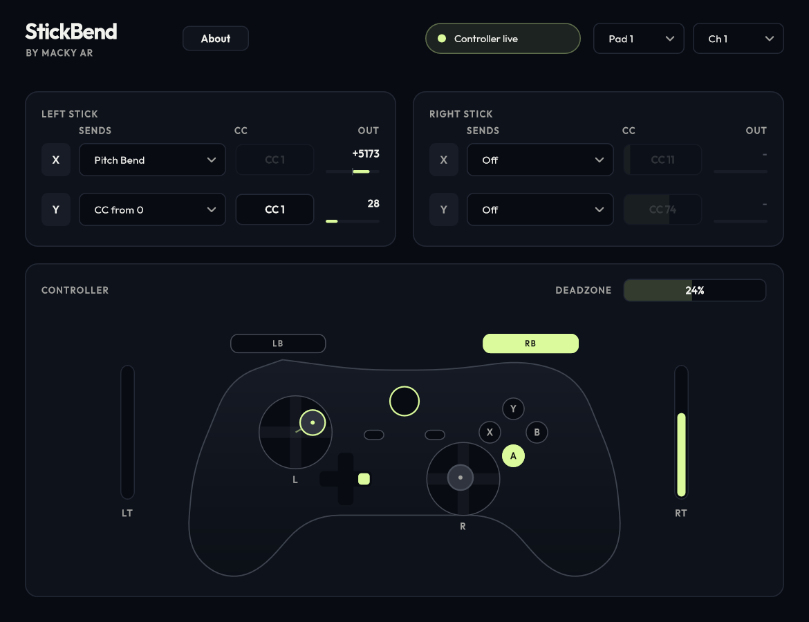

# StickBend

**Play your keyboard. Bend with your thumb.**

StickBend turns an ordinary game controller into an expressive MIDI controller. Bend notes, swell the mod wheel and ride any CC with the analog sticks while you play your keyboard, all in real time.



## About

StickBend was built by musician **Macky Ar** (Mahesh Arora), a multi-instrumentalist who wanted pitch bend to feel as natural as moving a thumb. Pitch wheels are small, stiff and stuck on the left of the keyboard. A game controller is cheap, familiar and comfortable to hold, which makes expressive playing accessible to anyone, on any keyboard, including players who find a pitch wheel awkward to reach or grip.

- Website: [mackyar.com](https://www.mackyar.com)
- Spotify: [Macky Ar](https://open.spotify.com/artist/1l0nNfz6ftZ5qgg8VcisYB)
- Bandcamp: [mackyar.bandcamp.com](https://mackyar.bandcamp.com/)
- YouTube: [@MackyAr](https://www.youtube.com/@MackyAr)
- Instagram: [@macky_ar](https://www.instagram.com/macky_ar/)
- Email: [macky.business725@gmail.com](mailto:macky.business725@gmail.com)

## Features

- Map each stick axis (left X/Y, right X/Y) to **pitch bend**, **any MIDI CC** (centred or from zero) or nothing.
- Your keyboard's MIDI passes straight through, untouched.
- Adjustable deadzone, MIDI channel and controller slot (1 to 4).
- Four **Stick parameters** you can link to any knob in your DAW, or record as automation that plays back as real bends and CCs.
- Everything it sends is ordinary MIDI, so recorded bends and CCs stay **fully editable** afterwards.
- Live controller visualizer showing both sticks, the deadzone, triggers and buttons.
- Silent at rest: a centred stick sends nothing, so it never overwrites recorded bends on playback.

## Requirements

- Windows 10 or 11 (64-bit)
- A VST3 or CLAP host (REAPER, Bitwig, Cubase, Studio One, FL Studio and others)
- An Xbox-compatible (XInput) controller. Xbox One/Series pads, most third-party PC pads, and 8BitDo in X-input mode all work. PlayStation pads work through [DS4Windows](https://ds4-windows.com/).

## Install

1. Close your DAW.
2. Copy `StickBend.vst3` to `C:\Program Files\Common Files\VST3\`
3. Copy `StickBend.clap` to `C:\Program Files\Common Files\CLAP\`
4. Open your DAW and rescan plugins.

## Quick start (REAPER)

1. On your instrument track, click **IN FX** (input FX) and add **StickBend**.
2. Keep your synth in the normal FX chain.
3. Arm the track and turn on record monitoring. Move the left stick: X bends pitch, Y drives the mod wheel.
4. Record. The stick moves land in the MIDI item as normal pitch bend and CC data, editable in the MIDI editor's CC lanes.

To record the Stick parameters as automation instead, put the track in **Latch** or **Write** mode and arm the "Stick" envelopes.

Not hearing the bend? Check that StickBend sits before the synth, and that the synth's own pitch bend range isn't set to 0. If your host has trouble with the VST3, try the CLAP version.

## Download and source

- Download: [github.com/Mackyar/StickBend/releases](https://github.com/Mackyar/StickBend/releases)
- Source code: [github.com/Mackyar/StickBend](https://github.com/Mackyar/StickBend)

## Build from source

Needs CMake 3.22+ and Visual Studio 2022 or newer.

```bash
cmake -S . -B build
```

```bash
cmake --build build --config Release --target StickBend_VST3 StickBend_CLAP
```

JUCE and the CLAP extensions are downloaded automatically during configure.

## Privacy

StickBend collects nothing and never connects to the internet. See [PRIVACY.md](PRIVACY.md).

## Licence

Copyright (C) 2026 Mahesh Arora (Macky Ar)

StickBend is free software: you can redistribute it and/or modify it under the terms of the GNU Affero General Public License version 3, as published by the Free Software Foundation. It is distributed in the hope that it will be useful, but WITHOUT ANY WARRANTY. See [LICENSE](LICENSE) for the full text and [THIRD_PARTY_NOTICES.md](THIRD_PARTY_NOTICES.md) for the components it includes.

VST is a registered trademark of Steinberg Media Technologies GmbH.
